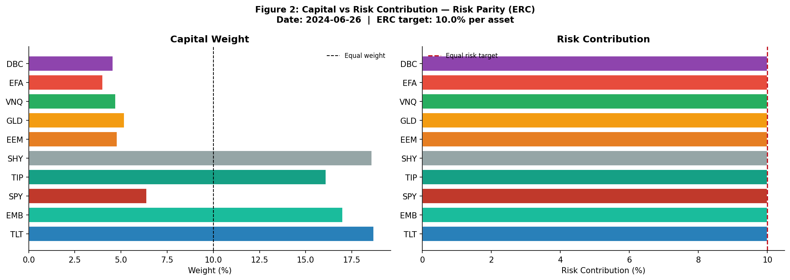

# Risk Parity Research

[](https://github.com/JoshGutierrez56/Risk-Parity-Model/actions/workflows/validation.yml)

**Equal-risk-contribution portfolios with Python optimization and DuckDB analytics.**

A compact multi-asset research project that connects covariance estimation, constrained portfolio weights and auditable return accounting. It compares **ERC**, **inverse volatility**, **equal weight** and a **60% SPY / 40% TLT proxy** across ten ETFs.

**Explore the code:** [ERC solver](src/riskparity/optimizer.py) | [rolling covariance](sql/covariance.sql) | [portfolio accounting](sql/backtest.sql) | [validation tests](tests/) | [methodology](docs/METHODOLOGY.md)

## The research question

Equal dollar weights do not imply equal risk. How do portfolio allocations change when each asset is assigned the same share of portfolio variance, with correlations included?

For covariance matrix `Sigma` and fully invested weights `w`, the target is:

```text
risk_share_i = w_i * (Sigma @ w)_i / (w.T @ Sigma @ w) = 1 / N
```

The [Python solver](src/riskparity/optimizer.py) minimizes squared deviations from that target using SciPy SLSQP. Inverse volatility is a useful baseline; it agrees with ERC for diagonal covariance but not generally for correlated assets.

## One implementation, two complementary layers

| Layer | Responsibility |
|---|---|
| Python / pandas | Validate and load a complete adjusted-price panel; explicit synthetic mode for offline checks |
| DuckDB SQL | Log returns, pairwise rolling covariance, risk-share diagnostics, drifting-holdings NAV, drawdown and summary metrics |
| Python / SciPy | Solve ERC; generate ERC and baseline target weights and write them to DuckDB |
| Python / matplotlib | Render figures from the SQL results |

The CLI uses a trailing **60-observation population covariance** of log returns, with a **30-observation minimum**, and recomputes targets every **21 available trading observations**. This is not calendar-month rebalancing or a Ledoit-Wolf shrinkage estimator.

## Synthetic demonstration



*Generated with seed 42 using the offline command below. Unequal capital weights target approximately 10% risk share per asset. These are simulated prices, not historical investment results; the displayed date belongs to the simulation.*

## Run it locally

Use **Python 3.11** for the pinned reference environment. The source supports Python 3.10+, but the reference workflow is checked on Python 3.11 on Linux and Windows. Create and activate a virtual environment before installing, then run commands from the repository root:

```bash
git clone https://github.com/JoshGutierrez56/Risk-Parity-Model.git
cd Risk-Parity-Model
python -m pip install --require-hashes -r requirements-lock.txt
python -m pytest tests -q

# Offline demonstration: no download, broker account or credentials
python -X utf8 run_risk_parity.py --synthetic --start 2023-01-01 --end 2024-06-30

# Same calculation, skipping figure generation
python -X utf8 run_risk_parity.py --synthetic --start 2023-01-01 --end 2024-06-30 --scorecard
```

For a separate market-data experiment, omit `--synthetic`; the loader requests adjusted closes from yfinance and **fails on download or coverage errors** rather than substituting simulated data. That online path is not part of the offline verification. Rerunning replaces generated database inputs and weights; outputs are local artifacts, not a cumulative research archive.

Outputs include `data/risk_parity.duckdb`, figure files under `outputs/figures/` and `outputs/tables/performance_summary.csv`. `--scorecard` still runs the calculation; it does not merely read an existing scorecard.

[`requirements-lock.txt`](requirements-lock.txt) pins the complete reference environment and package hashes. [`requirements.txt`](requirements.txt) records the broader dependency ranges; changing those ranges does not update the checked lock automatically. To deliberately refresh the lock, run `uv pip compile requirements.txt --python-version 3.11 --universal --generate-hashes --output-file requirements-lock.txt`, then run the tests and offline demonstration. The [CI workflow](.github/workflows/validation.yml) runs both on each published `main` commit and pull request, without credentials or market-data downloads.

## What is checked

The [ERC tests](tests/test_erc_math.py) cover positive, fully invested weights, equal risk shares and diagonal/correlated covariance cases. The [SQL accounting tests](tests/test_sql_accounting.py) use hand-derived examples to check:

- Strictly prior decision-date weights: no target earns its own decision-day return.
- Buy-and-hold drift between rebalances and economically valid simple-return compounding.
- Pair-grain rolling covariance and full-covariance risk contributions.
- First-day loss against initial NAV = 1, and annualization that includes every earned return.
- Rejection of missing held-asset returns, incomplete inputs and silent synthetic substitution.

**Verified on October 14, 2026:** 18 tests passed; the 18-month synthetic CLI run completed all ten figures and its summary CSV. This validates the tested mechanics, not investment performance.

## Interpretation limits

- **Execution:** close-date targets apply to the next close-to-close return under an idealized frictionless convention. It is not evidence that closing-price signals can be executed at that same close in practice.
- **Economics:** no transaction costs, taxes, financing, volatility targeting or leverage. The 60/40 comparator uses long-duration Treasuries, not a broad bond index.
- **Data:** complete positive finite panels are required; missing prices/covariances are not filled. Adjusted-price revisions and point-in-time availability remain outside this prototype.
- **Metrics:** Sharpe uses arithmetic daily returns, sample volatility and zero risk-free rate; CAGR uses 252 return observations per year. A rolling Sharpe needs a full 252-return window.
- **Inference:** synthetic outputs demonstrate accounting and optimization only. There is no claim of alpha, robustness across market regimes or deployable trading performance.

See [methodology and repair notes](docs/METHODOLOGY.md) for the precise timing, data and validation contracts.

## Source provenance

The working implementation is now directly browsable in [`src/`](src/), [`sql/`](sql/) and [`tests/`](tests/). [`risk_parity_sql.zip`](risk_parity_sql.zip) is the **unchanged legacy source snapshot**, retained for provenance. It predates the accounting/parser repairs and must not be extracted over the current implementation.

Conceptual reference: Maillard, Roncalli and Teiletche (2010), *The Properties of Equally Weighted Risk Contribution Portfolios*.
